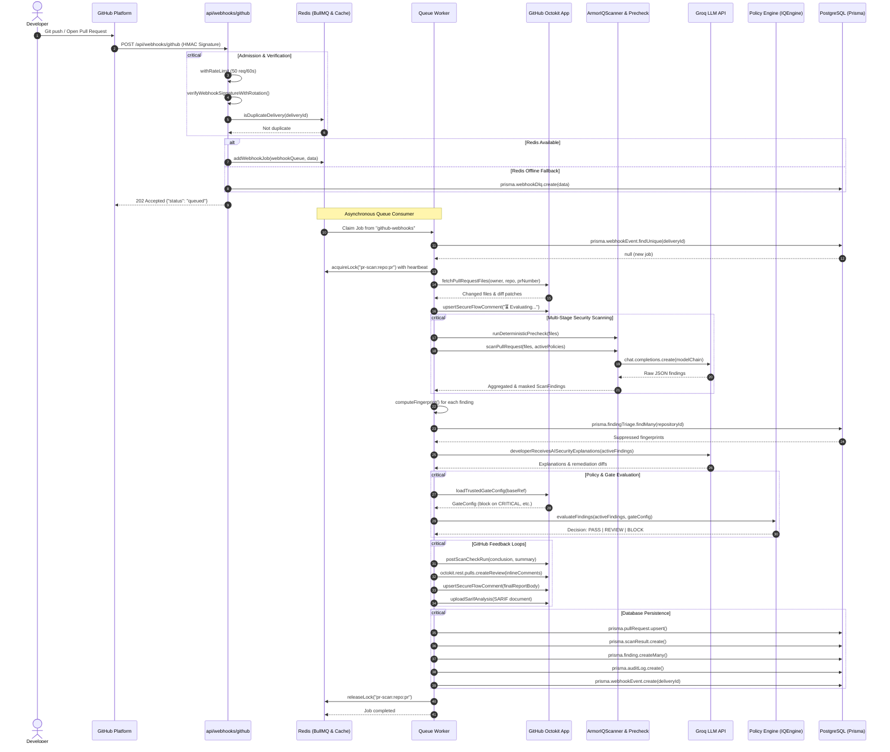
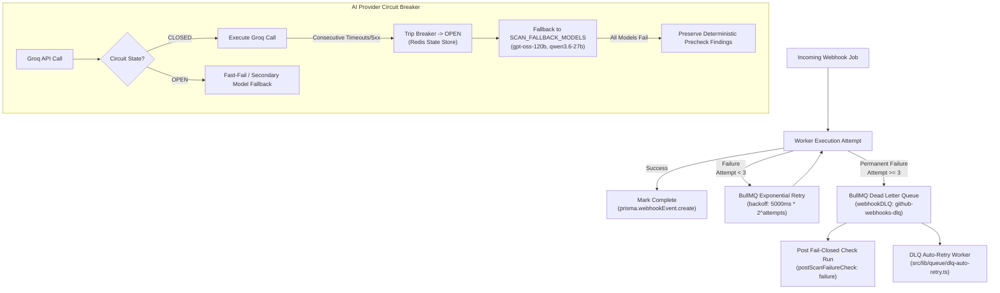
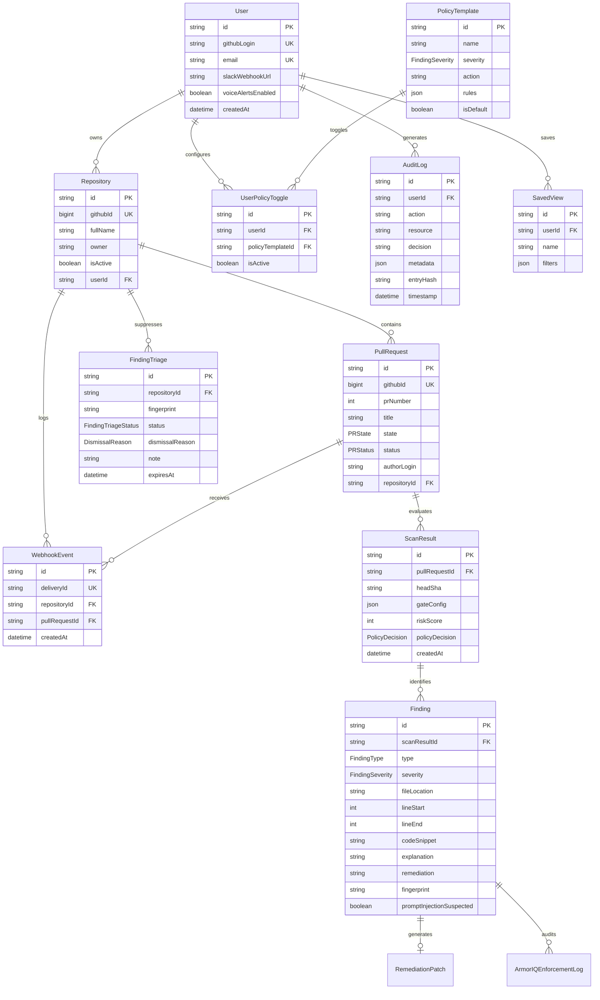

# SecureFlow Architecture & Pipeline Specification

This document provides a comprehensive technical overview of SecureFlow's architecture, event-driven pipeline, policy engine, and data model.

Every module, class, function, and database table name documented here matches the production codebase so new and existing contributors can navigate and search directly.

---

## Table of Contents

- [1. System Topology Overview](#1-system-topology-overview)
- [2. Component Architecture Diagram](#2-component-architecture-diagram)
- [3. End-to-End Pull Request Lifecycle](#3-end-to-end-pull-request-lifecycle)
- [4. Sequence Diagram: Webhook to PR Check Run](#4-sequence-diagram-webhook-to-pr-check-run)
- [5. Policy & Gate Enforcement Engine](#5-policy--gate-enforcement-engine)
- [6. Resilience, Dead-Letter Queues (DLQ) & Circuit Breakers](#6-resilience-dead-letter-queues-dlq--circuit-breakers)
- [7. PostgreSQL Data Model (Prisma Schema)](#7-postgresql-data-model-prisma-schema)
- [8. Key Source File Directory](#8-key-source-file-directory)

---

## 1. System Topology Overview

SecureFlow is built on **Next.js (App Router)** and adopts an asynchronous, event-driven micro-pipeline for processing GitHub pull requests and security events:

1. **Ingest & Verify**: Route handlers receive webhook HTTP POST deliveries, enforce rate limits, verify HMAC SHA-256 signatures with secret rotation support, and atomically deduplicate delivery IDs in Redis.
2. **Buffer & Decouple**: Validated webhook jobs are pushed to **BullMQ / Redis** queues (`github-webhooks`). Webhook endpoints respond immediately with `202 Accepted` to guarantee GitHub webhook SLAs (< 10 seconds).
3. **Distributed Worker Processing**: A dedicated background worker (`src/lib/queue/worker.ts`) claims jobs, acquires lease-renewed distributed locks per PR (`pr-scan:<repo>:<pr>`), fetches diffs, and orchestrates security scanning.
4. **Multi-Stage Security Scanning**:
   - **Deterministic Pre-Check**: Fast regex and entropy checks detect known secrets before LLM calls.
   - **Input Masking**: Ingress file lines are sanitized and known secrets redacted.
   - **AI Scanning**: Diff chunks are sent to **Groq LLM** (`openai/gpt-oss-20b` with automated model fallback).
   - **Fingerprinting & Triage Reconciliation**: Findings receive stable fingerprints (`computeFingerprint`) and are filtered against previously dismissed triage entries (`FindingTriage`).
   - **AI Reasoning**: Active findings are enriched with explanations and remediation code fixes via Genkit flows.
5. **Policy & Gate Evaluation**: `IQEngine` evaluates findings against base-branch gate configuration (`gate.yaml` / `.secureflow.yml`) and user policy toggles, producing a verdict (`PASS`, `REVIEW`, `BLOCK`).
6. **GitHub & Dashboard Feedback**:
   - Posts GitHub Check Run status (`success`, `neutral`, `failure`).
   - Posts or updates sticky PR summary comments (`upsertSecureFlowComment`).
   - Publishes inline review comments anchored to diff lines (`octokit.rest.pulls.createReview`).
   - Uploads SARIF analysis to GitHub Code Scanning (`uploadSarifAnalysis`).
   - Dispatches Slack, Microsoft Teams, and ElevenLabs voice alerts.
7. **Storage & Audit Trail**: Persists scan results, findings, and cryptographically chained audit events to **PostgreSQL via Prisma**.

---

## 2. Component Architecture Diagram

The diagram below illustrates how external actors, Next.js route handlers, Redis queues, background workers, scanning engines, and PostgreSQL interact:

```mermaid
flowchart TD
    subgraph GitHubPlatform["GitHub Platform"]
        GH_Webhook["GitHub Webhooks\n(pull_request, installation)"]
        GH_Checks["GitHub Checks API\n(Check Runs)"]
        GH_Reviews["GitHub Pulls API\n(Inline Comments & Sticky Summary)"]
        GH_CodeScan["GitHub Code Scanning\n(SARIF Upload)"]
    end

    subgraph IngestionLayer["Ingestion Layer (Next.js Route Handlers)"]
        Route_Webhook["src/app/api/webhooks/github/route.ts\n(POST Handler)"]
        MW_RateLimit["src/lib/middleware/rate-limit.ts\n(withRateLimit: 50 req/60s)"]
        Sec_Verify["src/lib/github/webhook-verification.ts\n(HMAC SHA-256 + Secret Rotation)"]
        Sec_Dedup["src/lib/github/webhook-dedup.ts\n(isDuplicateDelivery - 24h TTL)"]
    end

    subgraph RedisQueueLayer["Queue & Concurrency Layer (Redis + BullMQ)"]
        Q_Webhooks["BullMQ: github-webhooks\n(webhookQueue)"]
        Q_WebhookDLQ["BullMQ: github-webhooks-dlq\n(webhookDLQ)"]
        Redis_Lock["Distributed Lock\n(pr-scan:repo:pr)"]
        Redis_CB["Circuit Breaker Store\n(RedisCircuitBreakerStateStore)"]
    end

    subgraph WorkerSubsystem["Background Worker Subsystem"]
        Worker_Main["src/lib/queue/worker.ts\n(Worker<WebhookJobData>)"]
        Worker_DLQ["src/lib/queue/dlq-auto-retry.ts\n(dlqAutoRetryWorker)"]
        Worker_Remediation["src/lib/queue/remediationDlq.ts\n(remediationDlqWorker)"]
    end

    subgraph ScanningAndPolicy["Scanning & Policy Engine"]
        Engine_Precheck["src/lib/armor/precheck.ts\n(runDeterministicPrecheck)"]
        Engine_Masking["src/lib/armor/secret-masking.ts\n(maskIngressFileContent, maskSecrets)"]
        Engine_Scanner["src/lib/armor/scanner.ts\n(ArmorIQScanner.scanPullRequest)"]
        Engine_IQ["src/lib/armor/iq.ts\n(IQEngine.evaluateFindings)"]
        Engine_Gate["src/lib/scanner/gate-config.ts\n(loadTrustedGateConfig)"]
        Engine_Fingerprint["src/lib/armor/fingerprint.ts\n(computeFingerprint)"]
    end

    subgraph AIInference["AI Inference & Reasoning Layer"]
        Groq_Client["Groq LLM API\nPrimary: openai/gpt-oss-20b\nFallback: openai/gpt-oss-120b"]
        AI_Explanations["src/ai/flows/developer-receives-ai-security-explanations.ts\n(Genkit Flow)"]
        AI_Resilience["src/ai/resilience.ts\n(CircuitBreaker & Model Chain)"]
    end

    subgraph StorageLayer["Persistence Layer (PostgreSQL via Prisma)"]
        DB_Prisma["Prisma ORM Client\n(@/lib/prisma)"]
        Table_Repo[("Repository")]
        Table_PR[("PullRequest")]
        Table_Scan[("ScanResult")]
        Table_Finding[("Finding")]
        Table_Triage[("FindingTriage")]
        Table_Audit[("AuditLog / AuditEventLedger")]
        Table_Event[("WebhookEvent")]
        Table_DLQ[("WebhookDlq (DB Fallback)")]
    end

    subgraph NotificationHub["Integrations & Alerts"]
        Alert_Slack["Slack Webhook\n(notifyHighSeverityFindings)"]
        Alert_Teams["Teams Webhook\n(notifyBlockedScan)"]
        Alert_Voice["ElevenLabs / Redis PubSub\n(publishVoiceAlert)"]
    end

    %% Ingestion Flow
    GH_Webhook --> Route_Webhook
    Route_Webhook --> MW_RateLimit
    MW_RateLimit --> Sec_Verify
    Sec_Verify --> Sec_Dedup
    Sec_Dedup -->|Valid & New| Q_Webhooks
    Route_Webhook -.->|Redis Down Fallback| Table_DLQ
    Route_Webhook -->|202 Accepted| GH_Webhook

    %% Queue to Worker
    Q_Webhooks --> Worker_Main
    Worker_Main <--> Redis_Lock
    Worker_Main -->|Attempts Exceeded| Q_WebhookDLQ
    Worker_DLQ <--> Q_WebhookDLQ

    %% Worker Scanning Flow
    Worker_Main --> Engine_Precheck
    Worker_Main --> Engine_Masking
    Worker_Main --> Engine_Scanner
    Engine_Scanner <--> AI_Resilience
    AI_Resilience <--> Groq_Client
    AI_Resilience <--> Redis_CB

    Worker_Main --> Engine_Fingerprint
    Worker_Main --> AI_Explanations
    AI_Explanations <--> Groq_Client

    Worker_Main --> Engine_Gate
    Worker_Main --> Engine_IQ

    %% Feedback Flow
    Worker_Main --> GH_Checks
    Worker_Main --> GH_Reviews
    Worker_Main --> GH_CodeScan
    Worker_Main --> Alert_Slack
    Worker_Main --> Alert_Teams
    Worker_Main --> Alert_Voice

    %% Persistence Flow
    Worker_Main --> DB_Prisma
    DB_Prisma --> Table_Repo
    DB_Prisma --> Table_PR
    DB_Prisma --> Table_Scan
    DB_Prisma --> Table_Finding
    DB_Prisma --> Table_Triage
    DB_Prisma --> Table_Audit
    DB_Prisma --> Table_Event
```



---

## 3. End-to-End Pull Request Lifecycle

### Phase 1: Ingestion & Admission Control

1. **HTTP Ingestion**: GitHub delivers a POST request to `/api/webhooks/github`.
2. **Rate Limiting**: `withRateLimit` enforces an IP/token window of 50 requests per 60 seconds (`webhook:github`).
3. **Header Validation**: `content-length` is checked against `GITHUB_WEBHOOK_MAX_BYTES` (default: 10 MB) before buffering. Delivery ID is extracted from `x-github-delivery`.
4. **Signature Verification**: `verifyWebhookSignatureWithRotation` validates `x-hub-signature-256` using constant-time comparison against current and previous rotation secrets.
5. **Deduplication**: `isDuplicateDelivery` performs an atomic Redis `SET ... NX EX 86400`. If duplicate, returns `200 OK` without enqueuing.
6. **Queue Buffering**: `addWebhookJob` pushes `{ payload, deliveryId, event, correlationId }` to BullMQ `webhookQueue` with a deterministic `jobId: webhookJobId(deliveryId)` and `replaceFailed: true`.
7. **Immediate Acknowledgment**: The route immediately returns HTTP `202 Accepted` (`{"status":"queued", "deliveryId", "correlationId"}`).

### Phase 2: Background Worker Execution

1. **Job Claim**: `Worker<WebhookJobData>("github-webhooks")` in `src/lib/queue/worker.ts` receives the job.
2. **Idempotency Gate**: Checks `prisma.webhookEvent.findUnique({ where: { deliveryId } })`. If already processed, skips cleanly.
3. **Distributed Lock**: Acquires Redis lock `pr-scan:<repo>:<pr>` for 60 seconds with heartbeat renewal every 20 seconds. If locked by a concurrent scan, delays job by 15 seconds (`job.moveToDelayed`).
4. **GitHub Client Creation**: Obtains installation credentials via `getGitHubAppCredentials()` and instantiates an authenticated Octokit client (`appClient.getInstallationOctokit(installation.id)`).
5. **Diff Extraction**: `fetchPullRequestFiles` fetches changed files via paginated API calls. Removed files are excluded; added and modified files with diff patches are retained.
6. **Initial Status Comment**: `upsertSecureFlowComment` posts or updates a sticky PR comment with a pending message: `⏳ Evaluating changed files...`.

### Phase 3: Multi-Stage Scanning & AI Analysis

1. **Deterministic Pre-Check**: `runDeterministicPrecheck` scans unified diff hunks using regex families (AWS keys, GitHub tokens, Slack keys, PEM private keys, high-entropy secrets) to guarantee detection even during LLM outages.
2. **Ingress Masking**: `maskIngressFileContent` redacts known credentials before sending code to the LLM.
3. **Consolidated LLM Scan**: `ArmorIQScanner.scanPullRequest` groups files into size-bounded batches and invokes Groq completions (`openai/gpt-oss-20b`).
   - If rate limits (429) or timeouts occur, the model chain automatically falls back to secondary models (`SCAN_FALLBACK_MODELS`: `openai/gpt-oss-120b`, `qwen/qwen3.6-27b`).
   - The scan is wrapped by `CircuitBreaker` (`src/ai/resilience.ts`) to avoid overloading downstream endpoints during provider outages.
4. **Post-Scan Sanitization**: `filterFalsePositives` strips placeholder credentials (e.g. in `.env.example`, `seed.ts`), and `maskSecrets` sanitizes finding descriptions and snippets.
5. **Content Fingerprinting**: `computeFingerprint` assigns a deterministic SHA-256 hash to each finding based on `repositoryId`, `fileLocation`, `type`, and normalized snippet.
6. **Triage Reconciliation**: Queries `prisma.findingTriage` for active suppressions matching the fingerprints. Suppressed findings do not count toward blocking decisions or risk scores.
7. **AI Enrichment**: Active findings are processed by `developerReceivesAISecurityExplanations` using Genkit + Groq to generate developer-friendly vulnerability explanations and concrete remediation code suggestions.

### Phase 4: Policy Evaluation & GitHub Feedback

1. **Gate Configuration**: `loadTrustedGateConfig` reads `.secureflow.yml` or `gate.yaml` strictly from the target repository's **base branch** (preventing PR authors from tampering with gate thresholds).
2. **Policy Evaluation**: `iq.evaluateFindings(activeFindings, gateConfig)` computes risk scores and issues one of three policy decisions:
   - `PASS`: No findings exceeding configured gate thresholds.
   - `REVIEW`: Medium/low severity findings require manual security review.
   - `BLOCK`: Critical findings or policy breaches block merge.
3. **GitHub Check Run**: `postScanCheckRun` sets the conclusion (`success`, `neutral`, `failure`) and renders finding breakdowns with action items.
4. **Inline Review Comments**: `octokit.rest.pulls.createReview` publishes inline comments anchored to specific lines in the diff (`commentableLineNumbers`).
5. **Sticky Summary Comment**: `upsertSecureFlowComment` updates the pending comment into the final **SecureFlow AI Security Report**.
6. **SARIF Upload**: `uploadSarifAnalysis` sends standard SARIF to GitHub Code Scanning for native alert triage.
7. **External Alerts**: Real-time notifications dispatched to Slack, Microsoft Teams, and voice debrief feeds.

### Phase 5: Persistence & Lock Release

1. **Prisma Transaction**:
   - `prisma.pullRequest.upsert`: Updates PR metadata and state (`OPEN`, `CLOSED`, `MERGED`).
   - `prisma.scanResult.create`: Persists risk score, gate config, and policy decision.
   - `prisma.finding.createMany`: Persists all findings (active and suppressed).
   - `prisma.auditLog.create`: Writes an immutable audit entry with correlation IDs.
   - `prisma.webhookEvent.create`: Records `deliveryId` to prevent future re-execution.
2. **Lock Release**: Heartbeat timer is stopped and Redis lock released (`releaseLock`).

---

## 4. Sequence Diagram: Webhook to PR Check Run



---

## 5. Policy & Gate Enforcement Engine

SecureFlow separates **detection** from **enforcement**:

- **Detection**: `ArmorIQScanner` identifies vulnerabilities, secrets, and misconfigurations.
- **Enforcement**: `IQEngine` evaluates findings against hierarchical policy layers:

```
           +---------------------------------------------------+
           | Base Branch Gate Config (.secureflow.yml)         |
           | (Trusted default: Block on CRITICAL, Review HIGH) |
           +---------------------------------------------------+
                                    |
                                    v
           +---------------------------------------------------+
           | Custom Organization / User Policy Templates       |
           | (Active toggles in PolicyTemplate / UserPolicy)   |
           +---------------------------------------------------+
                                    |
                                    v
           +---------------------------------------------------+
           | Finding Triage Suppressions (FindingTriage)       |
           | (Excluded from risk score & blocking verdicts)    |
           +---------------------------------------------------+
                                    |
                                    v
                              Final Decision
                    [ PASS  |  REVIEW  |  BLOCK ]
```

### Decision Rules

- **BLOCK**: Any active finding violates a blocking rule (e.g. active `CRITICAL` finding or rule action `BLOCK`). Check run conclusion is set to `failure`.
- **REVIEW**: Findings require maintainer inspection (e.g. `HIGH` or `MEDIUM` severity). Check run conclusion is set to `neutral`.
- **PASS**: All findings are resolved, suppressed, or below enforcement thresholds. Check run conclusion is set to `success`.

---

## 6. Resilience, Dead-Letter Queues (DLQ) & Circuit Breakers

SecureFlow includes comprehensive failure-handling mechanisms to ensure that temporary outages or invalid payloads never compromise repository security.

### Failure Routing Topology



### Key Failure Controls

1. **Fail-Closed Security Guarantee**: If a scan fails permanently, `postScanFailureCheck` posts an error check run with `conclusion: "failure"`. This prevents pull requests with un-scanned commits from bypassing protected branch merge gates.
2. **Redis Ingestion Fallback**: If Redis is offline when a webhook arrives, `route.ts` falls back to inserting the raw payload into PostgreSQL table `WebhookDlq` to prevent data loss.
3. **Queue DLQ**: Jobs failing after 3 attempts are moved to BullMQ queue `github-webhooks-dlq`.
4. **Auto-Retry Worker**: `dlqAutoRetryWorker` inspects dead jobs and re-enqueues them using exponential backoff up to configured limits.
5. **AI Circuit Breaker**: `CircuitBreaker` (`src/ai/resilience.ts`) tracks consecutive errors across worker replicas via `RedisCircuitBreakerStateStore`. When tripped (`OPEN`), requests immediately route to fallback models (`SCAN_FALLBACK_MODELS`) or preserve deterministic pre-check findings.
6. **Distributed Lock Expiry**: Locks use short leases (60s) with active renewal heartbeats (20s). If a worker pod crashes, the lock automatically expires to avoid permanently stalling scans on that PR.
7. **Queue Fairness & Per-Installation Concurrency (#1980)**:
   - **Problem**: When a single installation opens many PRs at once (e.g. bulk Renovate/Dependabot upgrades or monorepo releases), its jobs can monopolize all worker slots, starving small PRs from other installations.
   - **Fair Scheduling**: `FairQueueScheduler` (`src/lib/queue/fair-scheduler.ts`) schedules waiting jobs in a round-robin rotation across active installations instead of strict FIFO.
   - **Per-Installation Concurrency Limit**: Capped by default to 2 concurrent running jobs per installation (configurable via `SCAN_INSTALLATION_CONCURRENCY_LIMIT` or `INSTALLATION_CONCURRENCY_LIMIT`). Excess jobs wait in their installation queue or yield via BullMQ `moveToDelayed`.
   - **PR Ordering & Locking**: Scans for the same pull request (`${repo}#${pr}`) never run in parallel and are strictly processed in FIFO order.
   - **DLQ and Retry Interaction**: Failed scans release their installation concurrency slot immediately. If retried, they re-enter the queue with backoff while maintaining head-of-line priority for that PR. Once max attempts are exhausted, the job routes to the DLQ (`webhookDLQ`), freeing capacity for subsequent jobs.
   - **Observability**: Real-time queue depths per installation are exposed via `/api/metrics/landing` (`secureflow_queue_depth_per_installation{installation="<id>"}`) and visualized in the Admin Queue Monitor (`/admin/queue`).

---

## 7. PostgreSQL Data Model (Prisma Schema)

The simplified Entity-Relationship diagram below displays the core tables, foreign key relations, and cardinalities:



---

## 8. Key Source File Directory

| Functional Area            | Source File Path                                              | Description                                                       |
| :------------------------- | :------------------------------------------------------------ | :---------------------------------------------------------------- |
| **Webhook Ingestion**      | `src/app/api/webhooks/github/route.ts`                        | Ingestion route handler, rate limit, verification, and enqueueing |
| **Webhook Security**       | `src/lib/github/webhook-verification.ts`                      | HMAC SHA-256 validation with zero-downtime secret rotation        |
| **Deduplication**          | `src/lib/github/webhook-dedup.ts`                             | Atomic Redis delivery ID deduplication with 24h TTL               |
| **Queue Definitions**      | `src/lib/queue/webhookQueue.ts`                               | BullMQ `github-webhooks` and `github-webhooks-dlq` setup          |
| **Fair Queue Scheduler**   | `src/lib/queue/fair-scheduler.ts`                             | Round-robin scheduler & per-installation concurrency limits       |
| **Queue Worker**           | `src/lib/queue/worker.ts`                                     | Core background job consumer, distributed lock, scan dispatcher   |
| **Distributed Locks**      | `src/lib/queue/lock.ts`                                       | Redis distributed lock primitives and heartbeat renewal           |
| **Deterministic Precheck** | `src/lib/armor/precheck.ts`                                   | High-speed regex and entropy secret scanner                       |
| **Secret Redaction**       | `src/lib/armor/secret-masking.ts`                             | Ingress and egress secret masking and redaction                   |
| **Scanner Engine**         | `src/lib/armor/scanner.ts`                                    | `ArmorIQScanner` diff parser, Groq client, and model failover     |
| **Policy Engine**          | `src/lib/armor/iq.ts`                                         | `IQEngine` finding evaluation against gate rules                  |
| **Gate Configuration**     | `src/lib/scanner/gate-config.ts`                              | Base-branch `.secureflow.yml` / `gate.yaml` loader                |
| **AI Explanations**        | `src/ai/flows/developer-receives-ai-security-explanations.ts` | Genkit explanation and remediation code generation flow           |
| **AI Resilience**          | `src/ai/resilience.ts`                                        | Multi-replica Redis circuit breaker and model failover router     |
| **Check Runs**             | `src/lib/scanner/check-run.ts`                                | GitHub Check Run creator and fail-closed error poster             |
| **PR Comments**            | `src/lib/github/sticky-comment.ts`                            | Sticky PR comment updater maintaining scan report                 |
| **Code Scanning**          | `src/lib/github/code-scanning.ts`                             | SARIF format generator and GitHub Code Scanning uploader          |
| **Database Schema**        | `prisma/schema.prisma`                                        | PostgreSQL relational schema and Prisma models                    |
