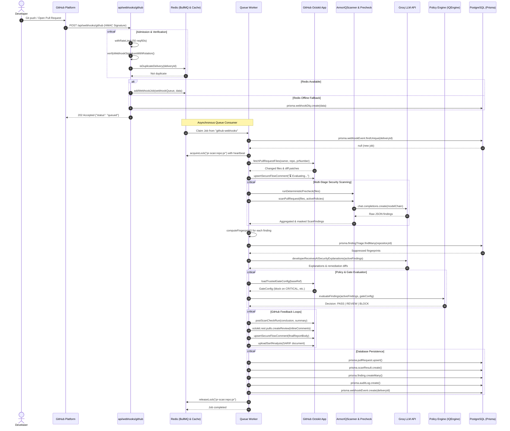
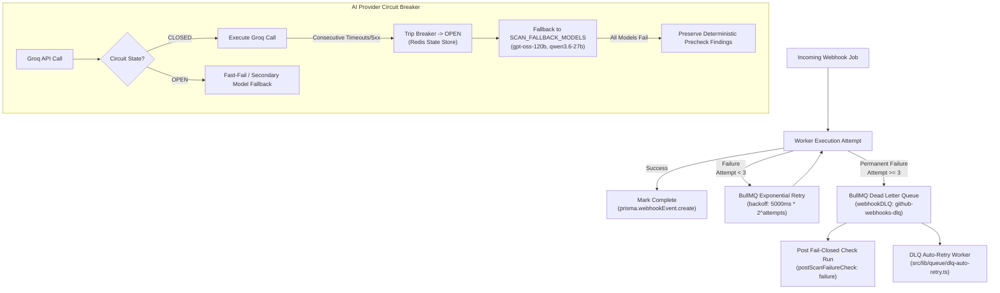
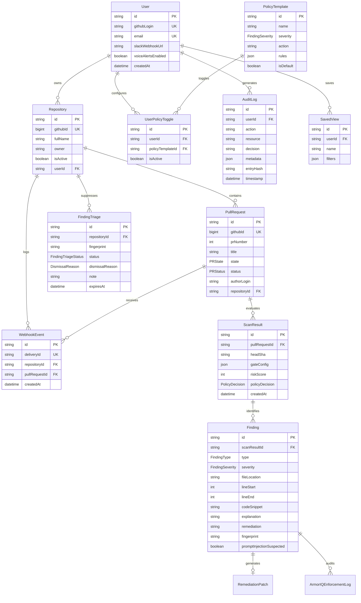

# SecureFlow Architecture & Contributor Guide

This document provides a comprehensive technical overview of SecureFlow's architecture: how the **CLI**, **GitHub Action**, **Dashboard**, and **AI Layer** fit together, along with an end-to-end data flow diagram and step-by-step instructions for extending the system.

Every module, class, function, and database table name documented here matches the production codebase so new and existing contributors can navigate and search directly.

---

## Table of Contents

- [1. System Topology & Component Responsibilities](#1-system-topology--component-responsibilities)
  - [1.1 SecureFlow CLI (`cli/`)](#11-secureflow-cli-cli)
  - [1.2 GitHub Actions CI Integration](#12-github-actions-ci-integration)
  - [1.3 Ingestion & Background Worker Pipeline](#13-ingestion--background-worker-pipeline)
  - [1.4 Multi-Stage Scanning & Rules Engine](#14-multi-stage-scanning--rules-engine)
  - [1.5 AI Reasoning & Remediation Layer](#15-ai-reasoning--remediation-layer)
  - [1.6 Policy & Gate Enforcement](#16-policy--gate-enforcement)
  - [1.7 Mission Control Dashboard](#17-mission-control-dashboard)
  - [1.8 Persistence Layer (PostgreSQL & Prisma)](#18-persistence-layer-postgresql--prisma)
- [2. End-to-End Data Flow: From Scan to Dashboard](#2-end-to-end-data-flow-from-scan-to-dashboard)
- [3. Pull Request Webhook Lifecycle](#3-pull-request-webhook-lifecycle)
- [4. Sequence Diagram: Webhook to PR Check Run](#4-sequence-diagram-webhook-to-pr-check-run)
- [5. Contributor Extension Guide](#5-contributor-extension-guide)
  - [5.1 Where to Add a New Security Rule](#51-where-to-add-a-new-security-rule)
  - [5.2 Where to Add a New AI Provider](#52-where-to-add-a-new-ai-provider)
  - [5.3 Where to Add a New Dashboard Page](#53-where-to-add-a-new-dashboard-page)
- [6. Resilience, Dead-Letter Queues (DLQ) & Circuit Breakers](#6-resilience-dead-letter-queues-dlq--circuit-breakers)
- [7. PostgreSQL Data Model (Prisma Schema)](#7-postgresql-data-model-prisma-schema)
- [8. Key Source File Directory](#8-key-source-file-directory)

---

## 1. System Topology & Component Responsibilities

SecureFlow provides end-to-end application and supply-chain security across the developer lifecycle, spanning pre-commit git hooks, CI/CD pipelines, automated pull request audits, and centralized web management:

```
[Developer Machine] ---> [Git Pre-Commit Hook / Husky] ---> [SecureFlow CLI]
                                                                  |
[GitHub Pull Request] ---> [GitHub Actions CI Workflow] --------->+
        |                                                         |
        +-----------------> [GitHub Webhook Handler]              |
                                    |                             |
                                    v                             v
                           [BullMQ Queue & Redis]        [SARIF / CLI Output]
                                    |
                                    v
                           [Background Worker]
                                    |
                    +---------------+---------------+
                    |                               |
                    v                               v
         [Deterministic Rules]             [AI Inference Layer]
         (Secrets, IaC, Actions)           (Groq, Ollama, vLLM)
                    |                               |
                    +---------------+---------------+
                                    |
                                    v
                          [IQEngine Policy Gate]
                                    |
         +--------------------------+--------------------------+
         |                          |                          |
         v                          v                          v
  [GitHub Check Runs]     [PR Sticky Comments]      [PostgreSQL Database]
                                                               |
                                                               v
                                                   [Mission Control Dashboard]
```

### 1.1 SecureFlow CLI (`cli/`)

The **SecureFlow CLI** (`cli/src/index.ts`) is a standalone command-line security scanner designed for developer machines and local pre-commit hooks:

- **Local Pre-Commit Guard**: Runs against staged git changes (`git diff --cached`) before commits are finalized, blocking exposed credentials with exit code `1`.
- **Ignore Management**: Evaluates `.secureflowignore` and default exclude lists (`cli/src/ignore.ts`).
- **Scan Caching**: Persists scan results in `.secureflow/cache` by content hash and ruleset version (`cli/src/cache.ts`).
- **Threat Intel MCP Server**: Hosts a Model Context Protocol (MCP) server over stdio for IDE agents (`cli/src/mcp/index.ts`).
- **Air-Gapped Local Mode**: Supports offline execution via `--local`, `--ollama`, or `--vllm` without external uploads (`cli/src/lib/local-mode.ts`).
- **Quality Gates & Exit Codes**: Implements `--fail-on <severity>` quality gates and configurable verbosity (`--quiet`, `--verbose`).

### 1.2 GitHub Actions CI Integration

SecureFlow runs natively inside GitHub Actions workflows (`.github/workflows/`):

- **Pull Request & Push Validation**: Scans changed files in pull request or push events via `npx secureflow-cli`.
- **Quality Gate Enforcement**: Fails CI jobs when vulnerabilities meet or exceed thresholds (e.g. `--fail-on high`).
- **SARIF Code Scanning Export**: Emits standard SARIF reports (`--format sarif -o results.sarif`) uploaded via `@github/codeql-action/upload-sarif` to the GitHub Security tab.
- **Job Summary Reporting**: Publishes execution metrics to `$GITHUB_STEP_SUMMARY`.

### 1.3 Ingestion & Background Worker Pipeline

SecureFlow's backend processes pull requests asynchronously through an event-driven queue:

- **Webhook Ingestion**: Next.js route handler (`src/app/api/webhooks/github/route.ts`) receives deliveries, verifies HMAC SHA-256 signatures with secret rotation (`src/lib/github/webhook-verification.ts`), deduplicates delivery IDs in Redis (`src/lib/github/webhook-dedup.ts`), and pushes jobs to BullMQ.
- **Fair Queue Scheduling**: `FairQueueScheduler` (`src/lib/queue/fair-scheduler.ts`) enforces round-robin processing across active installations to prevent monorepo bursts from starving smaller repositories.
- **Distributed Worker**: Background workers (`src/lib/queue/worker.ts`) claim jobs, acquire lease-renewed distributed locks per PR (`src/lib/queue/lock.ts`), fetch diffs, and coordinate scanning.

### 1.4 Multi-Stage Scanning & Rules Engine

Scanning combines high-speed deterministic pattern matching with contextual AI verification:

- **Deterministic Pre-Check**: Regex families and Shannon entropy analysis detect known secrets (AWS keys, GitHub tokens, PEM keys) in `src/lib/armor/secret-detector.ts` and `src/lib/armor/precheck.ts`.
- **Workflow Security Rules**: Inspects GitHub Actions workflows (`.github/workflows/*.yml`) for unpinned actions, script injection risks, and excessive permissions (`src/lib/rules/workflow-rules.ts`).
- **Dependency Rules**: Scans package manifests (`package.json`, `requirements.txt`, `go.mod`) for risky or vulnerable packages (`src/lib/rules/dependency-rules.ts`).
- **IaC Rules**: Validates Dockerfile, Kubernetes, Terraform, and Helm configurations (`src/lib/rules/iac-rules.ts`).
- **Ingress Masking**: Redacts sensitive strings prior to LLM dispatch (`src/lib/armor/secret-masking.ts`).

### 1.5 AI Reasoning & Remediation Layer

- **LLM Scanning**: `ArmorIQScanner` (`src/lib/armor/scanner.ts`) batches diffs to Groq (`openai/gpt-oss-20b`) or local providers (Ollama, vLLM).
- **Explanation & Patch Generation**: Genkit flows produce developer-friendly explanations and unified diff patches (`src/ai/flows/developer-receives-ai-security-explanations.ts`, `src/ai/flows/generate-remediation-patch.ts`).
- **Pre-Flight Patch Verification**: Automatically verifies generated patches against an isolated temporary copy of the target file (`src/lib/patch/patch-verifier.ts`), checking clean application and language syntax before presenting ready fixes.
- **Resilience & Circuit Breakers**: `CircuitBreaker` (`src/ai/resilience.ts`) tracks provider errors in Redis and falls back across secondary model chains (`SCAN_FALLBACK_MODELS`).

### 1.6 Policy & Gate Enforcement

- **Base-Branch Trust Anchor**: Gate configurations (`.secureflow.yml`, `gate.yaml`) are loaded strictly from the target repository's **base branch** (`src/lib/scanner/gate-config.ts`), preventing PR authors from altering enforcement thresholds.
- **IQEngine**: Evaluates active findings against gate thresholds, producing policy verdicts (`PASS`, `REVIEW`, `BLOCK`) in `src/lib/armor/iq.ts`.
- **Triage Suppression**: Reconciles findings against maintainer dismissals in PostgreSQL (`FindingTriage`), filtering out accepted risks and false positives via deterministic SHA-256 fingerprints (`src/lib/armor/fingerprint.ts`).

### 1.7 Mission Control Dashboard

The web dashboard is built using **Next.js App Router** and Tailwind CSS:

- **Mission Control Overview**: Central command center showing repository posture, recent scans, risk scores, and quick metrics (`src/app/dashboard/page.tsx`).
- **Findings & Breach Attempts**: Comprehensive list of detected vulnerabilities with severity filtering, triage actions, and dismissal workflows (`src/app/dashboard/findings/page.tsx`).
- **Remediation Interface**: Interactive side-by-side patch diff viewer and one-click fix generator (`src/app/dashboard/findings/[id]/remediation/page.tsx`).
- **Defense Strategy Policies**: Manage organizational policy templates and user toggles (`src/app/dashboard/policies/page.tsx`).
- **Vault Audit Logs**: Cryptographically verifiable audit ledger tracking every scan, policy change, and triage action (`src/app/dashboard/audit/page.tsx`).
- **Command Palette**: Keyboard-navigable quick switcher (`Ctrl+K` or `Cmd+K`) defined in `src/components/command-palette.tsx`.

### 1.8 Persistence Layer (PostgreSQL & Prisma)

Managed by **Prisma ORM** (`prisma/schema.prisma`):

- **Repositories & PRs**: `Repository`, `PullRequest`, `WebhookEvent`.
- **Scan Telemetry**: `ScanResult`, `Finding`, `RemediationPatch`, `FindingTriage`.
- **Security Policies**: `PolicyTemplate`, `UserPolicyToggle`.
- **Audit Ledger**: `AuditLog`, `AuditEventLedger`.

---

## 2. End-to-End Data Flow: From Scan to Dashboard

The Mermaid diagram below visualizes how security scans originate (CLI, GitHub Action, or Webhook), pass through parsing and AI evaluation, trigger GitHub feedback, persist to PostgreSQL, and render on the Mission Control Dashboard:

```mermaid
flowchart TD
    subgraph TriggerLayer["1. Trigger & Ingestion Layer"]
        Developer["Developer Workstation"]
        HuskyHook["Git Pre-Commit Hook\n(.husky/pre-commit)"]
        CLI["SecureFlow CLI\n(cli/src/index.ts)"]
        GH_Action["GitHub Actions Workflow\n(npx secureflow-cli)"]
        GH_PR["GitHub Pull Request Event\n(pull_request)"]
        WebhookRoute["Webhook Route Handler\n(src/app/api/webhooks/github/route.ts)"]
    end

    subgraph QueueLayer["2. Queue & Fair Scheduling Layer"]
        BullMQ["BullMQ Redis Queue\n(github-webhooks)"]
        FairScheduler["FairQueueScheduler\n(src/lib/queue/fair-scheduler.ts)"]
        PRLock["Redis Distributed Lock\n(pr-scan:repo:pr)"]
        Worker["Background Queue Worker\n(src/lib/queue/worker.ts)"]
    end

    subgraph ScannerLayer["3. Multi-Stage Scanning & Rules Engine"]
        Precheck["Deterministic Secret Precheck\n(src/lib/armor/precheck.ts)"]
        WorkflowRules["Workflow Security Rules\n(src/lib/rules/workflow-rules.ts)"]
        DepRules["Dependency Security Rules\n(src/lib/rules/dependency-rules.ts)"]
        IaCRules["IaC Security Rules\n(src/lib/rules/iac-rules.ts)"]
        Masking["Secret Redaction & Masking\n(src/lib/armor/secret-masking.ts)"]
        ArmorScanner["ArmorIQ Core Scanner\n(src/lib/armor/scanner.ts)"]
    end

    subgraph AILayer["4. AI Reasoning & Remediation Layer"]
        AI_Config["AI Provider Router\n(src/ai/model-config.ts)"]
        AI_Breaker["Circuit Breaker & Fallback Chain\n(src/ai/resilience.ts)"]
        AI_Providers["Inference Engines\n(Groq, Ollama, vLLM, OpenAI)"]
        AI_Flows["Explanations & Patch Flow\n(src/ai/flows)"]
        Patch_Verifier["Pre-Flight Patch Verifier\n(src/lib/patch/patch-verifier.ts)"]
    end

    subgraph PolicyLayer["5. Policy & Gate Enforcement"]
        GateConfig["Base-Branch Gate Config\n(.secureflow.yml)"]
        TriageStore["Finding Triage Reconciliation\n(FindingTriage)"]
        IQEngine["IQEngine Policy Evaluation\n(src/lib/armor/iq.ts)"]
        Verdict["Verdict: PASS | REVIEW | BLOCK"]
    end

    subgraph PersistenceLayer["6. Persistence Layer (PostgreSQL via Prisma)"]
        PrismaClient["Prisma ORM Client\n(@/lib/prisma)"]
        DB[("PostgreSQL Database\n(ScanResult, Finding, AuditLog, Triage)")]
    end

    subgraph FeedbackLayer["7. GitHub & CI/CD Feedback"]
        GH_Checks["GitHub Check Runs\n(Pass / Neutral / Blocked)"]
        GH_Comments["Sticky PR Summary & Inline Reviews"]
        GH_SARIF["GitHub Code Scanning\n(SARIF Upload)"]
    end

    subgraph DashboardLayer["8. Mission Control Dashboard (Next.js App Router)"]
        DashNav["Dashboard Navigation & Command Palette\n(src/components/dashboard-nav.tsx)"]
        PageOverview["Mission Control\n(src/app/dashboard/page.tsx)"]
        PageFindings["Breach Attempts / Findings\n(src/app/dashboard/findings/page.tsx)"]
        PageRemediation["Patch Remediation Viewer\n(src/app/dashboard/findings/[id]/remediation)"]
        PagePolicies["Defense Strategy Policies\n(src/app/dashboard/policies/page.tsx)"]
        PageAudit["Vault Audit Logs\n(src/app/dashboard/audit/page.tsx)"]
    end

    %% Trigger Connections
    Developer --> HuskyHook
    HuskyHook --> CLI
    CLI --> Precheck
    Developer --> GH_Action
    GH_Action --> CLI
    Developer --> GH_PR
    GH_PR --> WebhookRoute
    WebhookRoute --> BullMQ

    %% Queue to Worker
    BullMQ --> FairScheduler
    FairScheduler --> Worker
    Worker <--> PRLock
    Worker --> ArmorScanner

    %% Scanner Execution
    ArmorScanner --> Precheck
    ArmorScanner --> WorkflowRules
    ArmorScanner --> DepRules
    ArmorScanner --> IaCRules
    ArmorScanner --> Masking

    %% AI Pipeline
    Masking --> AI_Breaker
    AI_Config --> AI_Breaker
    AI_Breaker <--> AI_Providers
    AI_Providers --> AI_Flows
    AI_Flows --> Patch_Verifier

    %% Policy & Decisions
    ArmorScanner --> TriageStore
    TriageStore --> IQEngine
    GateConfig --> IQEngine
    IQEngine --> Verdict

    %% Persistence
    Worker --> PrismaClient
    CLI -.->|CLI Local/Cloud API| PrismaClient
    PrismaClient --> DB

    %% External Feedback
    Verdict --> GH_Checks
    Verdict --> GH_Comments
    Verdict --> GH_SARIF

    %% Dashboard Visualization
    DB --> PageOverview
    DB --> PageFindings
    DB --> PageRemediation
    DB --> PagePolicies
    DB --> PageAudit
    DashNav --> PageOverview
```



---

## 3. Pull Request Webhook Lifecycle

1. **HTTP Ingestion**: GitHub delivers a POST request to `/api/webhooks/github`.
2. **Rate Limiting**: `withRateLimit` enforces an IP/token window of 50 requests per 60 seconds (`src/lib/middleware/rate-limit.ts`).
3. **Header & Signature Verification**: Checks `content-length` and verifies HMAC SHA-256 signatures with secret rotation (`src/lib/github/webhook-verification.ts`).
4. **Deduplication**: `isDuplicateDelivery` executes an atomic Redis `SET ... NX EX 86400` check (`src/lib/github/webhook-dedup.ts`).
5. **Queue Buffering**: Enqueues job in BullMQ `github-webhooks` with deterministic `jobId` and returns HTTP `202 Accepted`.
6. **Worker Processing**: Background worker claims the job, acquires the distributed lock (`src/lib/queue/lock.ts`), and fetches changed file diffs.
7. **Scanning**: Executes deterministic checks, secret masking, and LLM completions.
8. **Policy Evaluation**: `IQEngine` evaluates findings against base-branch gate configuration.
9. **Feedback & Storage**: Updates GitHub Check Runs, posts PR review comments, uploads SARIF reports, and persists records to PostgreSQL in a Prisma transaction.

---

## 4. Sequence Diagram: Webhook to PR Check Run



---

## 5. Contributor Extension Guide

This section explains where and how new contributors can extend SecureFlow by adding rules, AI providers, and dashboard pages.

### 5.1 Where to Add a New Security Rule

SecureFlow separates rules into deterministic static checks and AI detection rules.

#### Step 1: Choose the Appropriate Rule Domain

- **Workflow Rules** (`src/lib/rules/workflow-rules.ts`): Inspects `.github/workflows/*.yml` for CI/CD security flaws (e.g. untrusted code checkout, unpinned actions, script injection).
- **Dependency Rules** (`src/lib/rules/dependency-rules.ts`): Scans software manifests (`package.json`, `requirements.txt`) for high-risk or malicious packages.
- **IaC Rules** (`src/lib/rules/iac-rules.ts`): Checks Dockerfiles, Terraform, Kubernetes, and Helm manifests for misconfigurations.
- **Secret Detection Rules** (`src/lib/armor/secret-detector.ts`): High-speed regex and entropy detection for hardcoded tokens and credentials.
- **CLI Secret Indicators** (`cli/src/scanner.ts`): Terminal-side secret logging patterns checked during pre-commit.

#### Step 2: Implement the Rule Function

In the corresponding file in `src/lib/rules/`, write a deterministic analysis function returning `ScanFinding[]`:

```typescript
// Example rule in src/lib/rules/workflow-rules.ts
export function checkCustomWorkflowSecurity(content: string, filename: string): ScanFinding[] {
  const findings: ScanFinding[] = [];
  // Parse AST or lines
  if (content.includes("dangerous-command")) {
    findings.push({
      type: "Dangerous CI Workflow Command",
      severity: "HIGH",
      description: "Detected execution of an unvalidated external script.",
      fileLocation: filename,
      codeSnippet: "dangerous-command",
      remediation: "Pin the script SHA or validate input parameters.",
    });
  }
  return findings;
}
```

#### Step 3: Register in the Scanner Engine

Wire your new rule into `ArmorIQScanner.scanPullRequest` in `src/lib/armor/scanner.ts`:

```typescript
// Inside ArmorIQScanner.scanPullRequest in src/lib/armor/scanner.ts:
const customFindings = checkCustomWorkflowSecurity(file.patch, file.filename);
deterministicFindings.push(...customFindings);
```

#### Step 4: Write Unit Tests

Add tests matching your rule in `src/lib/rules/<rule-file>.test.ts`:

```bash
npx vitest run src/lib/rules/workflow-rules.test.ts
```

---

### 5.2 Where to Add a New AI Provider

SecureFlow supports multiple LLM providers (`groq`, `ollama`, `vllm`, `openai`, `custom`) configured via `AI_PROVIDER`, `AI_MODEL`, and `AI_BASE_URL`.

#### Step 1: Register Provider Name

Add the provider to `SUPPORTED_AI_PROVIDERS` in:
- `src/ai/model-config.ts` (`SUPPORTED_AI_PROVIDERS = ["groq", "ollama", "vllm", "openai", "custom", "my_new_provider"] as const`)
- `cli/src/lib/local-mode.ts` (`SUPPORTED_AI_PROVIDERS`)

#### Step 2: Update Environment Schema

Add the provider to the Zod schema validation in `src/lib/env.ts`:

```typescript
// In src/lib/env.ts
AI_PROVIDER: z.enum(["groq", "ollama", "vllm", "openai", "custom", "my_new_provider"]).default("groq"),
```

#### Step 3: Configure Default Endpoints & Models

In `src/ai/model-config.ts`, define default model tags and endpoint fallbacks in `DEFAULT_PROVIDER_MODELS` and `DEFAULT_PROVIDER_URLS`:

```typescript
// In src/ai/model-config.ts
const DEFAULT_PROVIDER_MODELS = {
  // ...
  my_new_provider: "my-model-name",
};
```

#### Step 4: Wire Provider Adapter

In `src/ai/genkit.ts`, initialize the provider SDK instance inside `getAiInstance()` or configure the OpenAI-compatible HTTP client adapter.

#### Step 5: Configure Circuit Breaker & Fallbacks

In `src/ai/resilience.ts`, add model references to the fallback chain so outages degrade gracefully to secondary models.

#### Step 6: Verify Configuration Tests

Run the AI model configuration test suites:

```bash
npx vitest run src/ai/model-config.test.ts src/ai/genkit.test.ts cli/src/lib/local-mode.test.ts
```

---

### 5.3 Where to Add a New Dashboard Page

SecureFlow's dashboard uses Next.js App Router under `src/app/dashboard/`. To see production examples of dashboard views, reference existing implementations like `src/app/dashboard/audit/page.tsx` and `src/app/dashboard/findings/page.tsx`.

#### Step 1: Create the Page Route

Create a new directory and `page.tsx` file inside `src/app/dashboard/` (e.g. creating `src/app/dashboard/<your-view>/page.tsx` following the structure of `src/app/dashboard/audit/page.tsx`):

```tsx
import { Metadata } from "next";

export const metadata: Metadata = {
  title: "New Feature | SecureFlow",
};

export default async function NewFeaturePage() {
  return (
    <div className="space-y-6 p-6">
      <h1 className="text-2xl font-bold tracking-tight">New Security Feature</h1>
      <p className="text-muted-foreground">Manage and monitor feature metrics.</p>
    </div>
  );
}
```

#### Step 2: Register in Navigation Menu

Add the item to `NAV_ITEMS` in `src/components/dashboard-nav.tsx`:

```typescript
// In src/components/dashboard-nav.tsx
import { Sparkles } from "lucide-react";

const NAV_ITEMS = [
  // ...
  { name: "New Feature", href: "/dashboard/new-feature", icon: Sparkles },
];
```

#### Step 3: Register in Command Palette

Add the route to the searchable quick actions in `src/components/command-palette.tsx`:

```typescript
// In src/components/command-palette.tsx
const PAGES = [
  // ...
  { name: "New Feature", href: "/dashboard/new-feature", category: "Navigation" },
];
```

#### Step 4: Add Backend Route (If Needed)

If your page requires custom API data, create a route handler under `src/app/api/` (refer to existing handlers such as `src/app/api/findings/route.ts`):

```typescript
// In src/app/api/<your-view>/route.ts (modeled on src/app/api/findings/route.ts)
import { NextResponse } from "next/server";

export async function GET() {
  return NextResponse.json({ ok: true });
}
```

#### Step 5: Test the Page

Add a component test modeled after existing dashboard test suites (e.g., `src/app/dashboard/findings/page.test.tsx` or `src/app/dashboard/audit/page.test.tsx`) and verify with Vitest:

```bash
npx vitest run src/app/dashboard/findings/page.test.tsx
```

---

## 6. Resilience, Dead-Letter Queues (DLQ) & Circuit Breakers

SecureFlow includes comprehensive failure-handling mechanisms to ensure that temporary outages or invalid payloads never compromise repository security.

### Failure Routing Topology



### Key Failure Controls

1. **Fail-Closed Security Guarantee**: If a scan fails permanently, `postScanFailureCheck` (`src/lib/scanner/check-run.ts`) posts an error check run with `conclusion: "failure"`.
2. **Redis Ingestion Fallback**: If Redis is offline when a webhook arrives, `src/app/api/webhooks/github/route.ts` inserts the raw payload into PostgreSQL table `WebhookDlq`.
3. **Queue DLQ**: Jobs failing after 3 attempts are moved to BullMQ queue `github-webhooks-dlq` (`src/lib/queue/webhookQueue.ts`).
4. **Auto-Retry Worker**: `dlqAutoRetryWorker` (`src/lib/queue/dlq-auto-retry.ts`) inspects dead jobs and re-enqueues them using exponential backoff.
5. **AI Circuit Breaker**: `CircuitBreaker` (`src/ai/resilience.ts`) tracks consecutive errors across worker replicas via `RedisCircuitBreakerStateStore`.
6. **Distributed Lock Expiry**: Locks (`src/lib/queue/lock.ts`) use short leases (60s) with active renewal heartbeats (20s).

---

## 7. PostgreSQL Data Model (Prisma Schema)



---

## 8. Key Source File Directory

| Functional Area            | Source File Path                                              | Description                                                       |
| :------------------------- | :------------------------------------------------------------ | :---------------------------------------------------------------- |
| **CLI Entry Point**        | `cli/src/index.ts`                                            | CLI option parsing, scan orchestrator, output format router       |
| **CLI Pattern Scanner**    | `cli/src/scanner.ts`                                          | Secret detector, entropy calculator, and formatting engine        |
| **CLI Ignore Rules**       | `cli/src/ignore.ts`                                           | `.secureflowignore` parser and path glob matcher                  |
| **CLI Local Cache**        | `cli/src/cache.ts`                                            | Local hash cache and ruleset version invalidator                  |
| **CLI API Client**         | `cli/src/lib/api-client.ts`                                   | Remote scan and SBOM API client                                   |
| **CLI Terminal UI**        | `cli/src/lib/tui.ts`                                          | ANSI styling, progress indicator, and spinner                     |
| **Webhook Ingestion**      | `src/app/api/webhooks/github/route.ts`                        | Ingestion route handler, rate limit, verification, and enqueueing |
| **Webhook Security**       | `src/lib/github/webhook-verification.ts`                      | HMAC SHA-256 validation with zero-downtime secret rotation        |
| **Deduplication**          | `src/lib/github/webhook-dedup.ts`                             | Atomic Redis delivery ID deduplication with 24h TTL               |
| **Queue Definitions**      | `src/lib/queue/webhookQueue.ts`                               | BullMQ `github-webhooks` and `github-webhooks-dlq` setup          |
| **Fair Queue Scheduler**   | `src/lib/queue/fair-scheduler.ts`                             | Round-robin scheduler & per-installation concurrency limits       |
| **Queue Worker**           | `src/lib/queue/worker.ts`                                     | Core background job consumer, distributed lock, scan dispatcher   |
| **Distributed Locks**      | `src/lib/queue/lock.ts`                                       | Redis distributed lock primitives and heartbeat renewal           |
| **Deterministic Precheck** | `src/lib/armor/precheck.ts`                                   | High-speed regex and entropy secret scanner                       |
| **Secret Detection**       | `src/lib/armor/secret-detector.ts`                            | Regex and entropy-based credential detector                      |
| **Secret Redaction**       | `src/lib/armor/secret-masking.ts`                             | Ingress and egress secret masking and redaction                   |
| **Workflow Rules**         | `src/lib/rules/workflow-rules.ts`                             | GitHub Actions workflow security checks                           |
| **Dependency Rules**       | `src/lib/rules/dependency-rules.ts`                           | Package manifest vulnerability rules                              |
| **IaC Rules**              | `src/lib/rules/iac-rules.ts`                                  | Infrastructure as Code configuration checks                       |
| **Scanner Engine**         | `src/lib/armor/scanner.ts`                                    | `ArmorIQScanner` diff parser, Groq client, and model failover     |
| **Policy Engine**          | `src/lib/armor/iq.ts`                                         | `IQEngine` finding evaluation against gate rules                  |
| **Gate Configuration**     | `src/lib/scanner/gate-config.ts`                              | Base-branch `.secureflow.yml` / `gate.yaml` loader                |
| **AI Model Configuration** | `src/ai/model-config.ts`                                      | AI provider definitions and model resolution                      |
| **AI Genkit Adapter**      | `src/ai/genkit.ts`                                            | Provider SDK initialization and instance management               |
| **AI Explanations**        | `src/ai/flows/developer-receives-ai-security-explanations.ts` | Genkit explanation flow                                           |
| **AI Remediation Patches** | `src/ai/flows/generate-remediation-patch.ts`                  | Automated patch generation flow                                   |
| **AI Resilience**          | `src/ai/resilience.ts`                                        | Multi-replica Redis circuit breaker and model failover router     |
| **Patch Verification**     | `src/lib/patch/patch-verifier.ts`                             | Isolated temporary workspace patch apply & syntax validation      |
| **Check Runs**             | `src/lib/scanner/check-run.ts`                                | GitHub Check Run creator and fail-closed error poster             |
| **PR Comments**            | `src/lib/github/sticky-comment.ts`                            | Sticky PR comment updater maintaining scan report                 |
| **Code Scanning**          | `src/lib/github/code-scanning.ts`                             | SARIF format generator and GitHub Code Scanning uploader          |
| **Mission Control Page**   | `src/app/dashboard/page.tsx`                                  | Next.js dashboard overview page                                   |
| **Findings Page**          | `src/app/dashboard/findings/page.tsx`                         | Findings list and triage UI                                       |
| **Dashboard Navigation**   | `src/components/dashboard-nav.tsx`                            | Main sidebar navigation items                                     |
| **Command Palette**        | `src/components/command-palette.tsx`                          | Quick navigation keyboard switcher (`Cmd+K`)                      |
| **Database Schema**        | `prisma/schema.prisma`                                        | PostgreSQL relational schema and Prisma models                    |
