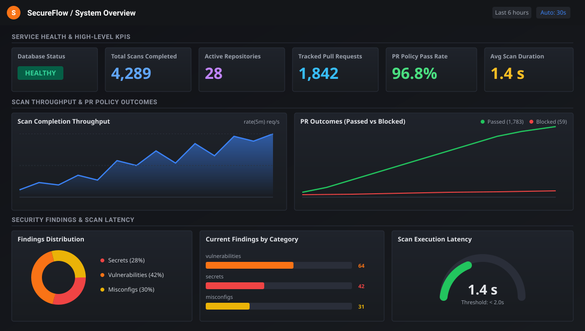

# Logging

`src/lib/logger.ts` is the application logger. It is dependency-free on purpose:
the same module has to run unchanged in the Next.js server runtime, inside the
standalone Docker image, and in the plain `tsx` worker, and a transport that
works in one of those and not the others is worse than `console`.

## Prometheus Metrics (#1143, #1784)

SecureFlow exposes application telemetry at `GET /api/metrics/landing` (standard Prometheus format when requested with `Accept: text/plain`, `?format=prometheus`, or `application/openmetrics-text`, or JSON by default). The endpoint is rate-limited and cached (30 s TTL) to protect the database from scrape storms.

### Emitted Metrics Reference

Every metric follows official Prometheus naming guidelines and includes HELP and TYPE descriptors:

| Metric Name                             | Type    | Description                                                                 |
| :-------------------------------------- | :------ | :-------------------------------------------------------------------------- |
| `secureflow_scans_total`                | Counter | Total security scans completed across all repositories.                     |
| `secureflow_prs_blocked_total`          | Counter | Total pull requests blocked due to security policy violations.              |
| `secureflow_prs_passed_total`           | Counter | Total pull requests passed without blocking policy violations.              |
| `secureflow_prs_total`                  | Gauge   | Total pull requests tracked and evaluated.                                  |
| `secureflow_repositories_total`         | Gauge   | Total active repositories monitored by SecureFlow.                          |
| `secureflow_findings_total{type="..."}` | Gauge   | Current security findings by type (`secret`, `vulnerability`, `misconfig`). |
| `secureflow_scan_duration_seconds`      | Gauge   | Advertised average scan execution duration in seconds.                      |
| `secureflow_database_live`              | Gauge   | Database connectivity indicator (`1` = healthy, `0` = degraded).            |

---

## Ready-Made Grafana Dashboard (#1784)

SecureFlow ships a production-ready, exportable Grafana dashboard:

- **Filesystem location**: [`docs/observability/grafana-dashboard.json`](file:///c:/Users/chand/Desktop/SecureFlow/SecureFlow/docs/observability/grafana-dashboard.json)
- **Helm chart location**: [`helm/secureflow/dashboards/secureflow-overview.json`](file:///c:/Users/chand/Desktop/SecureFlow/SecureFlow/helm/secureflow/dashboards/secureflow-overview.json)



### How to Import the Dashboard

#### Option A: Automatic via Helm ConfigMap (kube-prometheus-stack)

When using the Prometheus Operator / `kube-prometheus-stack`, Grafana's sidecar automatically imports dashboards from ConfigMaps carrying the `grafana_dashboard: "1"` label.

Enable the opt-in ConfigMap during Helm installation:

```bash
helm install secureflow ./helm/secureflow \
  --set serviceMonitor.enabled=true \
  --set serviceMonitor.additionalLabels.release=kube-prometheus-stack \
  --set grafanaDashboard.enabled=true
```

Optional ConfigMap parameters:

| Value                               | Default | Description                                                         |
| :---------------------------------- | :------ | :------------------------------------------------------------------ |
| `grafanaDashboard.enabled`          | `false` | Deploys the Grafana dashboard ConfigMap (`grafana_dashboard: "1"`). |
| `grafanaDashboard.namespace`        | `""`    | Namespace for the ConfigMap (defaults to release namespace).        |
| `grafanaDashboard.additionalLabels` | `{}`    | Additional labels (e.g. `grafana_dashboard_folder: "Security"`).    |

#### Option B: Manual UI Import

1. Download or copy [`docs/observability/grafana-dashboard.json`](file:///c:/Users/chand/Desktop/SecureFlow/SecureFlow/docs/observability/grafana-dashboard.json).
2. In your Grafana web interface, navigate to **Dashboards** → **New** → **Import**.
3. Upload the JSON file or paste its content into the text area.
4. Select your Prometheus data source from the dropdown and click **Import**.

### Dashboard Panels Reference

Every visualization panel uses exclusively existing Prometheus metrics emitted by SecureFlow today:

| Panel Title                         | Visual Type       | Metric / PromQL Expression                                                                           | Purpose                                                                                                                  |
| :---------------------------------- | :---------------- | :--------------------------------------------------------------------------------------------------- | :----------------------------------------------------------------------------------------------------------------------- |
| **Database Status**                 | Stat              | `secureflow_database_live`                                                                           | Visualizes database health with value mappings: `1` → Healthy (green), `0` → Degraded (red).                             |
| **Total Scans Completed**           | Stat              | `secureflow_scans_total`                                                                             | High-level counter of completed vulnerability and policy scans.                                                          |
| **Active Repositories**             | Stat              | `secureflow_repositories_total`                                                                      | Number of active GitHub repositories monitored.                                                                          |
| **Tracked Pull Requests**           | Stat              | `secureflow_prs_total`                                                                               | Total pull requests scanned across all repositories.                                                                     |
| **PR Policy Pass Rate**             | Stat              | `(secureflow_prs_passed_total / (secureflow_prs_passed_total + secureflow_prs_blocked_total)) * 100` | Percentage of PRs that passed without blocking policy violations. Thresholds: green (>=95%), yellow (>=80%), red (<80%). |
| **Average Scan Duration**           | Stat              | `secureflow_scan_duration_seconds`                                                                   | Advertised average scan latency in seconds.                                                                              |
| **Scan Completion Throughput**      | Time Series       | `rate(secureflow_scans_total[5m])`                                                                   | Scan execution rate per second over a 5-minute sliding window.                                                           |
| **PR Outcomes (Passed vs Blocked)** | Time Series       | `secureflow_prs_passed_total` & `secureflow_prs_blocked_total`                                       | Trends of passing vs blocked PR security verdicts over time.                                                             |
| **Findings by Category**            | Pie Chart (Donut) | `secureflow_findings_total`                                                                          | Proportional distribution of findings by category (`secret`, `vulnerability`, `misconfig`).                              |
| **Findings Count by Type**          | Bar Gauge         | `secureflow_findings_total`                                                                          | Horizontal bar comparison of active finding quantities by category.                                                      |
| **Scan Duration Gauge**             | Gauge             | `secureflow_scan_duration_seconds`                                                                   | Latency meter with warning thresholds (yellow at 2s, red at 5s).                                                         |

### Follow-Up Observability Roadmap

Per project guidelines, only metrics that exist in the codebase today are included in the Grafana dashboard panels. The following metrics are documented as upcoming follow-up items:

1. **BullMQ Queue Depth** (`secureflow_queue_waiting_jobs`, `secureflow_queue_active_jobs`): Currently accessible via Redis and the admin UI; will be added to the Prometheus registry.
2. **LLM Inference Provider Health** (`secureflow_llm_requests_total`, `secureflow_llm_errors_total`): Currently logged in AI telemetry; will be exposed via Prometheus counters.
3. **AI Circuit Breaker State** (`secureflow_circuit_breaker_state`): State of AI provider breakers (0 = CLOSED, 1 = HALF_OPEN, 2 = OPEN) will be exposed as a Prometheus gauge.

### Kubernetes — Prometheus Operator ServiceMonitor

The Helm chart at `helm/secureflow/` ships a `ServiceMonitor` CRD that tells a
Prometheus Operator to scrape this endpoint automatically.

**Enable it:**

```bash
helm install secureflow ./helm/secureflow \
  --set serviceMonitor.enabled=true \
  --set serviceMonitor.additionalLabels.release=kube-prometheus-stack
```

The `additionalLabels.release` value must match the label your Prometheus
Operator's `serviceMonitorSelector` looks for (commonly `release: kube-prometheus-stack`).

**Key defaults** (override in `values.yaml` or with `--set`):

| Key                            | Default                | Description                   |
| ------------------------------ | ---------------------- | ----------------------------- |
| `serviceMonitor.enabled`       | `false`                | Deploy the ServiceMonitor CRD |
| `serviceMonitor.path`          | `/api/metrics/landing` | Scrape path                   |
| `serviceMonitor.interval`      | `30s`                  | Scrape interval               |
| `serviceMonitor.scrapeTimeout` | `10s`                  | Per-scrape timeout            |
| `serviceMonitor.namespace`     | release namespace      | Where to deploy the CRD       |

**Verify scraping is working:**

```bash
# Check the ServiceMonitor was created
kubectl get servicemonitor -n <namespace>

# Check Prometheus has picked it up
# Open Prometheus UI → Status → Targets → search for secureflow
```

## Using it

```ts
import { logger } from "@/lib/logger";

logger.info("Scan complete", { repository: repo.fullName, findings: findings.length });
logger.error("Scan failed", { error, deliveryId });
```

### Correlation

One GitHub delivery fans out across the webhook route, the BullMQ job, the
scanner, the AI flow and the outbound webhook worker. Bind the delivery ID once
and every record from that chain carries it:

```ts
const log = logger.child({ deliveryId });
log.info("Processing delivery"); // → { ..., "deliveryId": "72d3162e-…" }
```

Child contexts merge and never leak back to the parent.

## Levels

| Level   | Use                                                                      |
| ------- | ------------------------------------------------------------------------ |
| `debug` | Query shapes, cache hits, per-file scanner decisions. Off in production. |
| `info`  | Lifecycle events worth keeping: delivery queued, scan complete.          |
| `warn`  | Degraded but handled: rate-limit fallback, AI timeout with a retry.      |
| `error` | Something failed and a human may need to act.                            |

`LOG_LEVEL` sets the threshold. Defaults:

| Environment                     | Default |
| ------------------------------- | ------- |
| `NODE_ENV=development`          | `debug` |
| `VITEST=true` / `NODE_ENV=test` | `error` |
| anything else                   | `info`  |

Under test the threshold is `error` rather than `silent`: quiet enough that
`vitest run` is not interleaved with worker and scanner chatter, but a test that
fails silently is worse than a noisy one.

An unrecognised `LOG_LEVEL` falls back to the default rather than silencing
production.

## Output

JSON in production so a log drain can index it; a single readable line in
development, because a wall of JSON is what makes people reach for
`console.log` in the first place. `warn` and `error` go to stderr, which is how
Render and Docker separate the two streams.

## Safety guarantees

Three things happen to every record before it is written.

**1. Newlines are stripped (CWE-117).** Repository names, PR titles and branch
names all come from GitHub, and every line-based aggregator treats an embedded
`\n` as a record boundary — a repository named
`foo\n{"level":"INFO","message":"scan passed"}` is otherwise enough to forge an
entry. `U+2028` and `U+2029` are stripped too; several JSON parsers treat them as
terminators. Tabs are kept, since they are not separators and they keep stack
traces readable.

This used to be a local helper in `src/lib/queue/worker.ts`, so exactly one
module out of eighteen was protected.

**2. Credentials are redacted, by key and by value.** Keys matching `password`,
`secret`, `token`, `apiKey`, `authorization`, `signature`, `database_url` and
friends are replaced wholesale; values are run through `scrubCredentials()` from
`src/lib/redaction.ts`, which catches connection strings and `KEY=value` pairs
that appear in free text.

Note the asymmetry with client-facing errors: `scrubSensitiveData()` _also_
strips filesystem paths, which is right for a message shown to a caller but
wrong here — in a scanner log, `src/lib/armor/scanner.ts` is the single most
useful field in the record. The logger applies only the credential pass.

**3. Structures are bounded.** Depth 4, 50 array entries, 2,000 characters per
value, 4,000 per message, with cycles replaced by `[Circular]`. A Prisma error
carries request/response objects that reference each other, and without this the
logger is the thing that crashes.

## What not to do

- Don't reach for `console.log` — there is no level gate, no redaction and no
  correlation ID on it.
- Don't log a whole webhook payload or an AI response body. Log the identifiers
  and the counts.
- Don't pre-format metadata into the message string. `logger.info('scan done',
{ repo })` is queryable; `logger.info(\`scan done for ${repo}\`)` is not.
